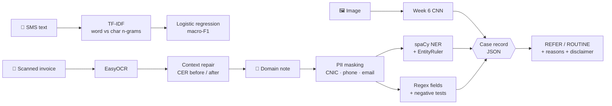

<div align="center">

# 📖 Week 7 · Text and Multimodal AI

### *My Project 2 model learned to read.*

**Introduction to Applied AI** · BS 8th Semester · Department of Electronics
Project 2: Deep Learning Applications (Individual)

> 🔗 **Builds on:** [Week 6 · Project 2 · X-ray image classifier](https://github.com/sulemantariq2026/Week-6-Project-2-XRAY), whose trained model (`week6_model.pt`) supplies the *image evidence* in the Week 7 case record.

## 🧭 What this project does

Six components, each measured, then fused into one explainable, privacy-safe record.



| # | Component | Technique | Metric reported |
|:-:|---|---|---|
| 1 | TF-IDF | Smooth IDF + L2 norm, reproduced by hand | hand values = library values; cosine(d2,d3) = 0.544 |
| 2 | Text classifier | Word 1-2 grams vs char 2-5 grams + logistic regression | macro-F1, spam precision / recall, top features |
| 3 | NER | spaCy `en_core_web_sm` + `EntityRuler` before `ner` | exact-match entity F1, before → after |
| 4 | Regex fields | CNIC, mobile, amount, date, email, invoice + domain patterns | positive **and** negative tests |
| 5 | OCR | EasyOCR + context repair (`O→0`, `l→1`, `N0.→No.`) | character error rate, before → after |
| 6 | Case record | Week 6 image model + text evidence, PII masked **first** | transparent JSON with reasons |

## 📊 Results

> Run the notebook, then `results.json` and `README_week7_section.md` are generated automatically.
> Paste your **measured** values here (the numbers below are the lab's published reference values to check against).

| Measurement | Reference | **Mine** |
|---|:-:|:-:|
| TF-IDF `d1` (win / free / cash / now) | 0.584 / 0.445 / 0.584 / 0.345 | |
| Cosine(d2, d3) | 0.54 | |
| Word 1-2 gram macro-F1 (SMS) | – | |
| Char 2-5 gram macro-F1 (SMS) | – | |
| NER F1, provided 6 sentences, out of the box | 0.533 | |
| NER F1, provided 6 sentences, with 7 rules | 0.875 | |
| NER F1, **my** held-out sentences, before → after | – | |
| CER on lab pairs, before → after | 0.062 / 0.059 / 0.143 → 0.000 | |
| CER on synthetic invoice, raw → fixed | – | |

## 📂 Repository layout

```
week7-text-multimodal-ai/
├── notebooks/
│   └── Week7_Text_and_Multimodal_AI.ipynb   ← the lab (Parts 1-7, a "Write it" cell after each)
├── src/
│   ├── __init__.py
│   └── text_tools.py                         ← tested regex / CER / OCR-repair / PII-masking helpers
├── tests/
│   └── test_text_tools.py                    ← 12 tests incl. negative + privacy tests
├── data/
│   └── README.md                             ← which dataset, how to get it
├── outputs/                                  ← results.json, case_record_example.json (generated)
├── docs/
│   └── linkedin_post_template.md
├── requirements.txt
├── .gitignore
└── README.md
```

## 🚀 Quick start

### Option A: Kaggle (recommended, this is what the lab uses)
1. Create a notebook **"Week 7 - Text and Multimodal"** and turn **Internet ON** (EasyOCR downloads ≈100 MB on first use).
2. **Add Data → search "SMS Spam Collection Dataset" (uciml)** → add. ([dataset page](https://www.kaggle.com/datasets/uciml/sms-spam-collection-dataset)) The notebook auto-finds `spam.csv` with `glob`, so any Kaggle folder layout works.
3. Upload your `week6_model.pt` as a **private dataset named `week6-model`** and add it.
4. Upload `notebooks/Week7_Text_and_Multimodal_AI.ipynb` (*File → Import Notebook*) and **Run All**.
5. Fill every **✏️ EDIT** cell (your 10 domain sentences, rules, patterns, `EXAMPLE_IMAGE`) and every **✍️ Write it** cell.

### Option B: local
```bash
git clone <your-repo-url> && cd week7-text-multimodal-ai
python -m venv .venv && source .venv/bin/activate       # Windows: .venv\Scripts\activate
pip install -r requirements.txt
python -m spacy download en_core_web_sm
python tests/test_text_tools.py                          # 12 tests, no GPU or internet needed
jupyter lab notebooks/
```
Download the dataset locally with the Kaggle CLI (see [`data/README.md`](data/README.md)) and change `path` in Task 2.1.

## 🔐 Privacy by design

Personal identifiers (**CNIC, phone, email**) are masked **before** any entity or field extraction.
An earlier version masked the displayed note but extracted entities from the *original*, so the phone number re-appeared inside `text_evidence`.
The notebook now (1) masks first and (2) runs an automatic **leak check** that fails if any digit of the phone/CNIC appears anywhere in the JSON.

## ⚠️ Honest limitations

* Entity F1 on 16 (or 10) gold entities is a **small sample**, so treat it as a demonstration of the method, not a benchmark.
* The synthetic invoice is clean (fixed font, perfect contrast). Expect much higher CER on real phone photos.
* The case record is **decision support only; a qualified human decides.**
* The SMS dataset is English / Roman-Urdu-light and from an older era of spam. Char n-grams help but do not make the model robust to new spam styles.

## 🧪 Example case record (shape)

```json
{
  "image": "example.jpeg",
  "image_probabilities": {"NORMAL": 0.18, "PNEUMONIA": 0.82},
  "note_masked": "Child aged 4, fever for 3 days and fast breath. Seen at PIMS Islamabad on 12/09/2026. Guardian mobile [PHONE].",
  "text_evidence": {
    "entities": [["PIMS", "ORG"], ["Islamabad", "GPE"], ["12/09/2026", "DATE"]],
    "fields": {"date": ["12/09/2026"]},
    "urgent_terms": ["fever", "breath"]
  },
  "decision": "REFER",
  "reasons": ["image model: P(PNEUMONIA) = 0.82", "note mentions: fever, breath"],
  "disclaimer": "Decision support only; a qualified human decides."
}
```
*(Illustrative only. Replace with the real output from your own Week 6 model.)*

## 📌 Week 7 summary (auto-generated by the notebook)

```
## Week 7: Text and Multimodal AI
- Text classifier: SMS Spam Collection, [n] texts, macro-F1 [x] (word) vs [x] (char)
- Top positive / negative features: [..] / [..]
- NER on my domain: out-of-the-box F1 [x] -> with entity ruler [x]
- Regex fields extracted: [..]; false positives tested: [..]
- OCR: CER raw [x] -> after correction rules [x]
- Pipeline: image model + text evidence -> JSON record (example below)
- Privacy: CNIC, phone, and email masked before logging
```

## 🛠️ Troubleshooting

| Symptom | Cause | Fix |
|---|---|---|
| `IsADirectoryError` reading the CSV | Path points to the folder, not the file | Use the `glob` finder in Task 2.1 (already in the notebook) |
| `UnicodeDecodeError` reading `spam.csv` | File is Latin-1, not UTF-8 | Keep `encoding='latin-1'` |
| `OSError: Can't find model 'en_core_web_sm'` | spaCy model missing | `python -m spacy download en_core_web_sm`, then restart |
| `ValueError: entity_ruler already exists` | Cell run twice | Use `build_nlp()` (fresh pipeline each time) |
| EasyOCR stuck on download | Internet off | Kaggle Settings → Internet **On** (≈100 MB first run) |
| `DEMO_MODE = True` in Part 6 | `week6_model.pt` not found | Add the `week6-model` dataset to the notebook |
| `size mismatch` loading the checkpoint | Backbone differs from training | Check `ckpt['backbone']` and `ckpt['classes']` |
| Phone digits visible in the JSON | Extraction ran before masking | Call `mask_pii` first, as `case_record` does |

## 👤 Author
**Your Name** Suleman Tariq
 Department of Electronics
Course: Introduction to Applied AI · Instructor: Dr. Faiz Ahmad
 [GitHub](https://github.com/sulemantariq2026)

## 📄 License & academic integrity
Code in `src/` is released under the **MIT License** (add a `LICENSE` file when you publish).
The lab instructions are © Dr. Faiz Ahmad, for enrolled students only, and are **not** redistributed here.
The SMS Spam Collection belongs to its original authors (UCI ML Repository); it is not included in this repo.
The domain gold set, patterns and written analysis in the notebook are my own work.

## ➡️ Next: Week 8
Serve the Project 2 model through a **FastAPI** endpoint (`pip install fastapi uvicorn`), Presentation 2, and Project 3 team formation.

---
<div align="center"><sub>Built for <b>Introduction to Applied AI</b> · Week 7 · #NLP #spaCy #MultimodalAI #LearningInPublic</sub></div>
